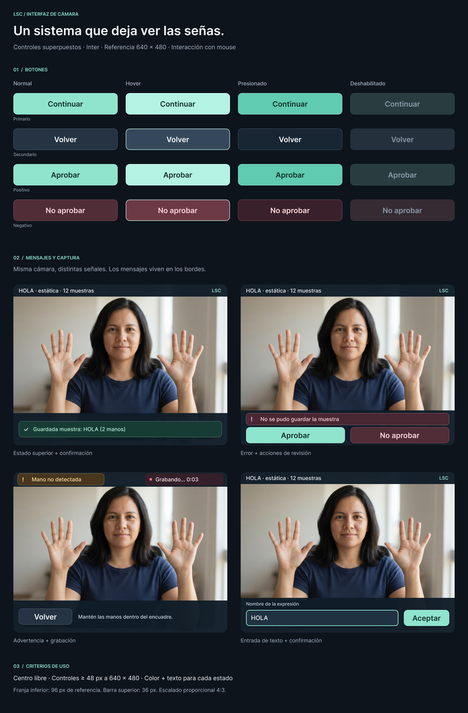

# Capture static and motion expressions with one or two hands
Size: complex — new table, two-hand capture, a recording mode with review before saving, and a mouse-driven UI in the capture window

## Visual reference
Figma mockups of the buttons (4 states each), messages, recording indicator and name input: https://www.figma.com/design/ObGLOmW6iqy0b35sBizIPe/LanguageSing (page "02 · Componentes", frame "Sistema de interfaz · LSC").

Reference size 640 × 480, scaled proportionally with the video. Bottom strip 96 px, top bar 36 px, controls ≥ 48 px, 16 px margins. Button variants: primary/positive (mint `#8fe4ce`, text `#102d28`), secondary (`#253342`), negative (`#512d38`, text `#ffd7dd`); states normal, hover, pressed, disabled. Strips use `rgba(16,28,40,0.96)`. Font in the mockup is Inter; the window uses Segoe UI (semibold for buttons) through `textdraw`.

## Goal
In the capture window the user can save samples of whole expressions such as "hola" or "mi nombre es", made with one or two hands. Each sample of an expression is either static (a single pose) or in motion (a sequence of frames), and the same expression can have both. Each capture is shown back to the user, who approves it or not, and only approved captures are saved. They then capture again, in a cycle, to build up samples of that expression for a later training spec. Every action is an on-screen button clicked with the mouse. Keys are only used to type a name.

## Happy path
- HP-1: Given the capture window has just opened, when it shows the menu, then the user sees two buttons, "Expresión estática" and "Expresión en movimiento".
- HP-2: Given the user clicked a mode, when they type a new name in the window (e.g. `hola`) and click "Aceptar" (or press Enter), then the expression is created in `epression` and the window shows the mode, the expression and its sample count: "HOLA · estática · 0 muestras".
- HP-3: Given an expression that already exists (in either mode), when the user confirms its name, then it is not created again; it opens with the samples already saved for it in the chosen mode, and the window shows that count, e.g. "HOLA · en movimiento · 12 muestras".
- HP-4: Given static mode with one or two hands visible, when the user clicks "Capturar", then the live video stops and the captured frame is shown frozen, with its landmarks drawn, together with the buttons "Aprobar" and "No aprobar".
- HP-5: Given a static capture is under review, when the user clicks "Aprobar", then one static `samples` row is saved with each visible hand identified as left or right, the window shows "Guardada muestra: HOLA (2 manos)", the sample count goes up by one ("HOLA · estática · 13 muestras") and it goes back to live video with "Capturar" enabled again.
- HP-6: Given motion mode, when the user clicks "Grabar", then recording starts, the window shows "Grabando..." with the elapsed time, and the button changes to "Detener".
- HP-7: Given a recording is in progress, when the user clicks "Detener", then the recording is replayed in a loop at its recorded speed, with landmarks drawn, together with the buttons "Aprobar" and "No aprobar".
- HP-8: Given a recording is under review, when the user clicks "Aprobar", then one motion `samples` row is saved for the recording, every recorded frame is saved in order in the new child table, the window shows "Guardada secuencia: HOLA (N frames)", the sample count goes up by one and it goes back to live video with "Grabar" enabled again.
- HP-9: Given a capture or recording is under review, when the user clicks "No aprobar", then nothing is saved, the sample count does not change, the window shows "Muestra descartada" and it goes back to live video ready to capture again.
- HP-10: Given an expression is active and nothing is under review, when the user clicks "Volver", then they return to the menu to choose another mode or expression.
- HP-11: Given either window (capture or `src/recognize_message.py`), when the user clicks the window's close button (X), then the app closes and releases the camera. No key closes a window.
- HP-12: Given vowel samples saved before this change, when `src/train/train.py` and `src/recognize_message.py` run, then they keep working on those samples as they do today.

## Sad paths
- SP-1: Given the name input, when the user confirms an empty name, then nothing is created and the window shows "Escribe un nombre para la expresión".
- SP-2: Given the database is unreachable when the user confirms a name, when the expression cannot be created or its samples counted, then they stay in the name input and the window shows "No se pudo conectar con la base de datos".
- SP-3: Given static mode with no hand visible, when the user clicks "Capturar", then no review is shown and the window shows "No se capturó: no se detectó ninguna mano".
- SP-4: Given a recording that captured fewer than 5 frames with at least one hand, when the user stops it, then no replay is shown and the window shows "No se grabó: secuencia demasiado corta".
- SP-5: Given a recording still running after 10 seconds, when that limit is reached, then the recording stops and its replay is shown, as in HP-7.
- SP-6: Given a recording is in progress or a capture is under review, when the user closes the window, then nothing is saved.
- SP-7: Given the user is not in the name input, when they press any key (including `q` and the vowels), then nothing happens.
- SP-8: Given the database is unreachable when the user clicks "Aprobar", when the save fails, then the window shows "No se pudo guardar la muestra" and stays in the review, so the user can try "Aprobar" again or click "No aprobar".
- SP-9: Given `DATABASE_URL` is missing, when the capture app starts, then it prints an error to stderr and exits with code 1 before opening the camera.

## Out of scope
- Training on and recognizing the new static and motion expressions (next spec).
- Storing the captured images or video. Only landmarks are saved, as today.
- Deleting or renaming expressions and samples from the app.

## Touches
- `src/capture/capture_words.py` (entrypoint: menu, name input, injects the repository)
- `src/camera.py` (`run_camera` loop: on-screen buttons and mouse clicks, name input, recording, frozen-frame and replay review; the `q` key and vowel keys are removed). `recognize_message.py` keeps using it, closing only with the window's X.
- `src/textdraw.py` (new: `draw_text`, Pillow text with accents and ñ) and `requirements.txt` (`pillow`)
- `src/hands.py` (`HandDetector`: left/right handedness for each detected hand, as shown in the mirrored frame)
- `src/dataset.py` (two-hand sample shape, per-hand normalization)
- `src/dbConf/schema.sql`, `src/dbConf/database.py` (`samples.kind`, the new child table, sample count per expression and kind, repository methods)
- `.sdd/project.md` (the convention "Exit camera loops cleanly with `q` key" becomes "close with the window's X")

## Decisions and open questions
- No keyboard shortcuts at all, letters included. `q` no longer closes, and a/e/i/o/u no longer save vowels: vowels are captured like any other static expression (type `a`, then "Capturar" and "Aprobar"). Ctrl+C in the terminal still stops the app.
- Keys only matter in the name input: letters (including ñ and accented vowels, since the expressions are in Colombian Spanish), digits and space type, Backspace deletes, and Enter is the same as "Aceptar". Names are stored lowercase, trimmed and with a maximum of 30 characters. Answer received.
- `cv2.putText` cannot draw ñ or accents, so every text in the window (buttons, messages, the typed name) is drawn with Pillow and the Windows font Segoe UI, through one helper in `src/textdraw.py`. `pillow` is added to `requirements.txt`. Risk to check in phase 2: whether the OpenCV window delivers ñ and accented keys when typed.
- All the buttons in this spec are drawn on the video and clicked with the mouse. Only the buttons that apply to the current state are shown; while reviewing, only "Aprobar" and "No aprobar". Clicks must hit the right button even when the window is resized (the video is scaled and centered on black bars).
- The image and video under review exist only in memory and are dropped after "Aprobar" or "No aprobar". What gets saved is the landmarks of the frozen frame or of each recorded frame, the same data that was shown.
- Scope: capture and saving only (answer received).
- The kind (static or motion) belongs to each sample, not to the expression: the same expression, e.g. `hola`, can have static and motion samples, and the count shown is for the chosen mode only. Existing samples are static. Answer received.
- Each hand is stored with `dataset.normalize_landmarks`, as today, plus the raw wrist position in the image. Otherwise normalization removes the hand's travel through space, which is what defines a motion sign. A hand that is not visible is stored as empty, not as zeros.
- A motion sample is one `samples` row (with no `points` of its own) plus one child row per frame, holding the frame index, the time since recording started in ms (the frame rate varies) and the hands. Child rows are deleted with their sample, and a sample and its frames are saved together or not at all. Frames with no hand visible are left out of the saved sample but still appear in the replay.
- `schema.sql` updates the existing Neon tables in place (new column, nullable `points`, new table). Current samples are not lost.
- Training keeps reading only the one-hand static vowel samples in today's format, so `train.py` does not break on the new rows.
- Minimum 5 frames and maximum 10 s per recording are defaults. They can be tuned after the first captures.
- Added after the first captures: clicking "Grabar" starts a 2-second countdown ("Prepárate..." with 2 and 1) and the recording starts when it ends, so the hands can get in place. The countdown is not part of the recording.
